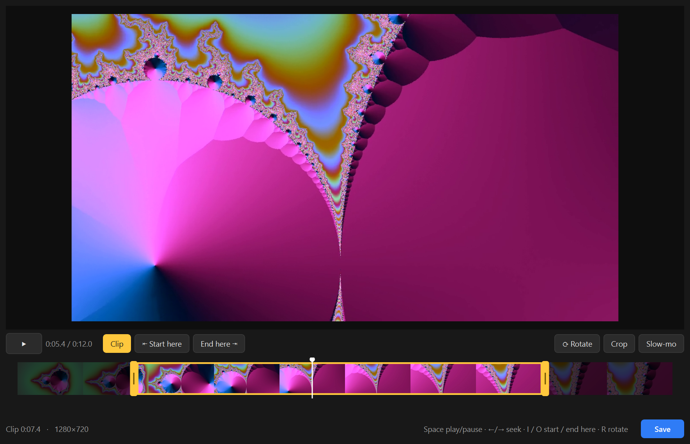
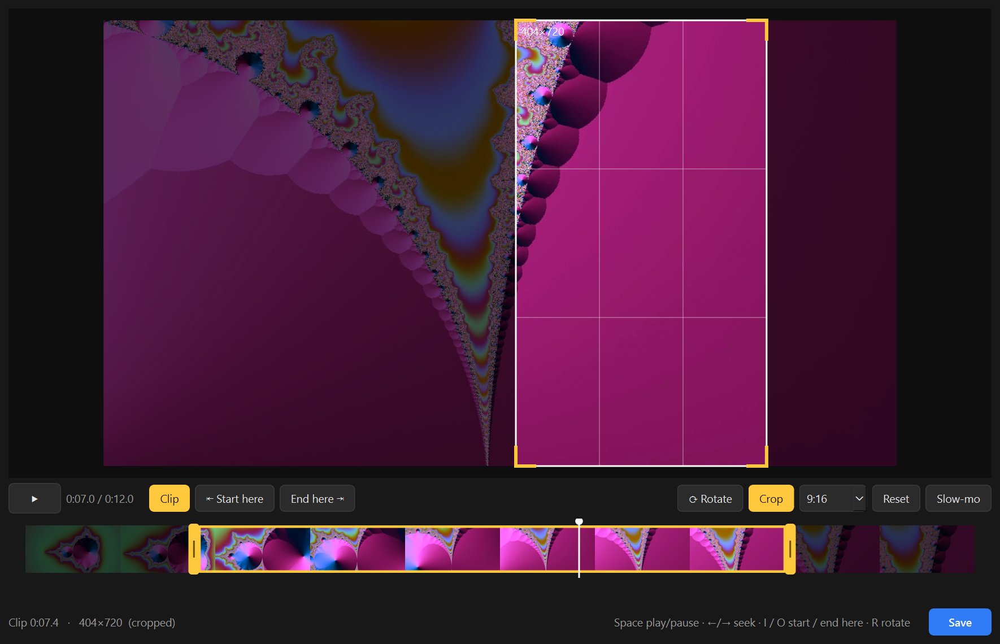
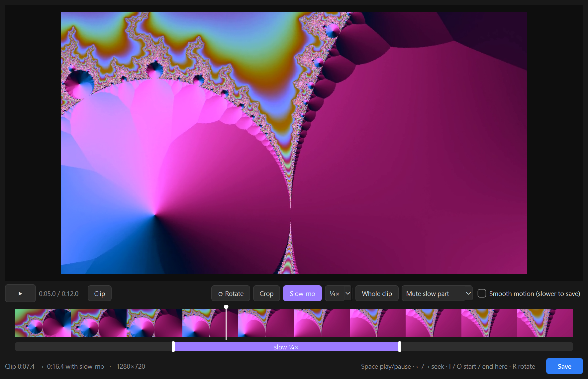

# VLC Editor

Quick mobile-style video clipping (trim, crop, slow-mo) launched from VLC.



| Crop | Slow-mo |
|------|---------|
|  |  |

## Use

1. In VLC, open a video and choose **View > Edit Video** (Mac: **VLC > Extensions > Edit Video**).
2. **Clip**: drag the yellow handles, or play to a spot and click **Start here** / **End here**.
   Click **Clip** when done and the timeline zooms in to the clip. Click it again to change it.
3. **Rotate**: each click turns the video 90° clockwise.
4. **Crop**: click **Crop** and drag the box. Click **Crop** again to see the result.
5. **Slow-mo**: click **Slow-mo**, drag the purple bar, and pick a speed.
6. **Save** writes `<name>_edit.mp4` next to the original.

Keys: Space play/pause · ←/→ seek · I / O start / end · R rotate · Ctrl+S save

## Install

Download your system's package from [Releases](https://github.com/deten/vlc-editor/releases).
VLC 3.x must be installed.

| System | File | Install |
|---|---|---|
| Windows | `…-windows-x64.zip` | Unzip, run **Install.cmd** |
| Mac (Apple chip) | `…-macos-arm64.zip` | Drag **VLC Editor** to Applications |
| Mac (Intel) | `…-macos-intel.zip` | Drag **VLC Editor** to Applications |
| Linux | `…-linux-x86_64.tar.gz` | `tar -xzf …tar.gz && ./vlc-editor/install.sh` |

Restart VLC afterwards.

**Mac:** the first time, macOS blocks the app. Run this in Terminal:

```sh
xattr -dr com.apple.quarantine "/Applications/VLC Editor.app"
```

Or open the app, click **Done**, then **Open Anyway** in **System Settings > Privacy & Security**.
On macOS 14 or earlier, Control-click the app and choose **Open**.

**Linux:** install VLC from your distribution, not Flatpak or Snap.

- Ubuntu: `sudo apt install vlc`
- Fedora: enable [RPM Fusion](https://rpmfusion.org/Configuration), then
  `sudo dnf swap ffmpeg-free ffmpeg --allowerasing` and `sudo dnf install vlc vlc-plugins-freeworld`

## Run from source

Windows (needs VLC, Python 3.12 and ffmpeg):

```powershell
powershell -ExecutionPolicy Bypass -File install.ps1
```

Mac / Linux (needs VLC, Python 3.10+ and ffmpeg):

```sh
python3 -m venv .venv
.venv/bin/pip install -r requirements.txt
.venv/bin/python editor/vlc_editor.py --install-extension
```

## Build

- Windows: `powershell -ExecutionPolicy Bypass -File build.ps1`
- Mac / Linux: `./build.sh`

Packages go to `dist/`. Pushing a `v*` tag builds, tests and publishes all of them.
